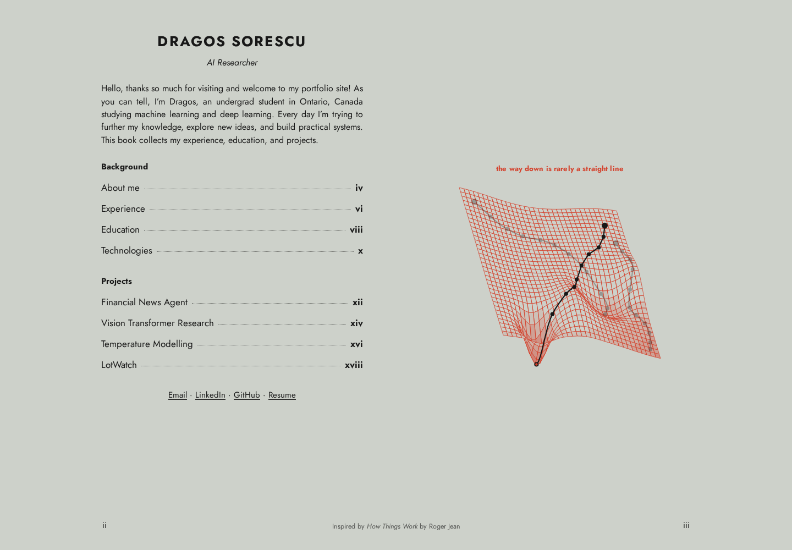

# Portfolio!!!

My portfolio of my background, experience, education, and machine learning projects. Built with plain HTML, CSS, and JavaScript, with original SVG diagrams, responsive layouts, and automatic light and dark themes.

[Visit the portfolio](https://sxres.dev/)

## Navigation

Select a chapter from the contents to open it. Use the left and right arrow keys to move between chapters, or press Escape to return to the contents. Each chapter also has a **Back to contents** link. Chapter links can be bookmarked, and browser Back and Forward work between chapters.

All chapter text is included in the initial HTML and remains readable without JavaScript. JavaScript adds the book transitions and illustrations.

The book design is inspired by *How Things Work* by Roger Jean.
